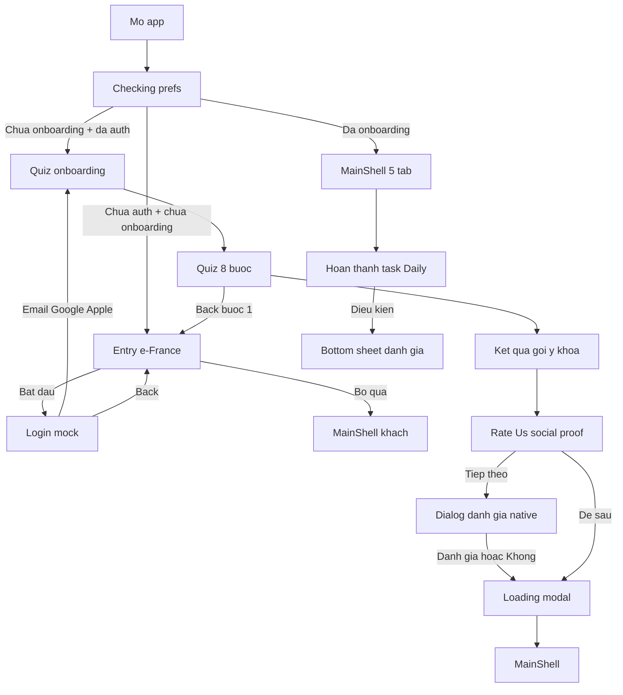
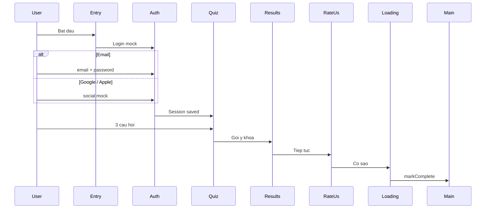
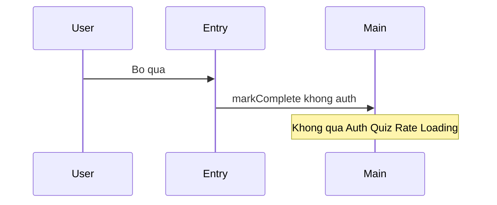

# Luồng màn hình GATS Academy

Tài liệu này mô tả **toàn bộ flow người dùng** trong app — từ lúc mở app lần đầu đến khi dùng các tab chính. Dùng để định hình sản phẩm, QA, và tham chiếu khi thêm màn mới.

**Entry point code:** [`lib/main.dart`](../lib/main.dart) → [`lib/app.dart`](../lib/app.dart) → [`AppBootstrap`](../lib/features/onboarding/presentation/app_bootstrap.dart)

---

## Tổng quan



---

## Phân nhánh: trạng thái người dùng

| Trạng thái | Auth | Onboarding | Màn đầu tiên |
|---|---|---|---|
| **Khách (bỏ qua Entry)** | Chưa | Đã xong | MainShell |
| **Đã đăng nhập, chưa onboarding** | Có | Chưa | Quiz (resume) |
| **Lần đầu hoàn toàn** | Chưa | Chưa | Entry Screen |
| **Đã hoàn tất** | Có hoặc không | Đã xong | MainShell |

**Prefs:**
- Auth: [`auth_prefs.dart`](../lib/core/services/auth_prefs.dart) — `auth_signed_in`, email, method
- Onboarding: [`onboarding_prefs.dart`](../lib/core/services/onboarding_prefs.dart) — `onboarding_complete`, course ids

---

## Phase 1 — Bootstrap (`AppBootstrap`)

| Phase | Màn hình | File | Mô tả ngắn |
|---|---|---|---|
| `checking` | Spinner | `app_bootstrap.dart` | Đọc auth + onboarding prefs |
| `entry` | Entry | `entry_screen.dart` | Chào e-France (dark) |
| `auth` | Login | `login_screen.dart` | **Auth giả** email / Google / Apple |
| `onboarding` | Quiz + Results | `onboarding_screen.dart` | Cá nhân hóa lộ trình |
| `rateUs` | Rate Us | `rate_us_screen.dart` | Đánh giá app |
| `loading` | Loading | `onboarding_loading_screen.dart` | Modal hoàn tất |
| `main` | MainShell | `main_shell.dart` | App chính |

---

## Phase 2 — Entry Screen

**Design:** e-France `TELA DE ENTRADA ESCURO.png`

| Thành phần | Hành động |
|---|---|
| **Bắt đầu** | → Login (nếu chưa auth) hoặc thẳng Quiz (nếu đã auth) |
| **Bỏ qua** | → MainShell **khách** (không auth, không quiz) |

```
Entry ──Bắt đầu──► Auth (mock) ──► Quiz onboarding
Entry ──Bỏ qua───► MainShell (guest)
```

---

## Phase 3 — Auth (mock, chưa backend)

**Design:** e-France `TELA LOGING ALUNO ESCURO.png`  
**File:** [`login_screen.dart`](../lib/features/auth/presentation/login_screen.dart)  
**Service:** [`mock_auth_service.dart`](../lib/features/auth/data/mock_auth_service.dart)

### Phương thức đăng nhập

| Phương thức | UI | Backend | Ghi chú |
|---|---|---|---|
| **Email + mật khẩu** | Tab Đăng nhập / Đăng ký | Mock delay 700ms | Email có `@`, mật khẩu ≥ 4 ký tự |
| **Google** | Nút outline | Mock user cố định | Chưa OAuth thật |
| **Apple** | Nút outline | Mock user cố định | Chưa Sign in with Apple |

Sau đăng nhập thành công → lưu session `AuthPrefs` → **Quiz onboarding**.

### UI chính

- Nền `darkCanvas` + vòng tròn decorative (e-France CODIGO pattern)
- Sheet bo tròn phía dưới
- Tab **ĐĂNG NHẬP** / **ĐĂNG KÝ** (accent)
- Email, mật khẩu (toggle hiện/ẩn)
- Quên mật khẩu → "Sắp có"
- Banner: *"Auth giả — chưa kết nối server"*
- Nút Google / Apple

### Đăng xuất

**Cài đặt → Đăng xuất** → `AuthPrefs.signOut()` → hot restart → Entry (nếu chưa reset onboarding).

---

## Phase 4 — Onboarding Quiz (8 bước)

**File:** [`onboarding_quiz_screen.dart`](../lib/features/onboarding/presentation/onboarding_quiz_screen.dart)  
**Ack overlay:** [`onboarding_answer_ack_sheet.dart`](../lib/features/onboarding/presentation/widgets/onboarding_answer_ack_sheet.dart)  
**Thứ tự bước:** enum `QuizStepId` trong [`onboarding_answers.dart`](../lib/features/onboarding/models/onboarding_answers.dart)

| Bước | Câu hỏi | Kiểu chọn | Ack |
|---|---|---|---|
| 1 | Bạn biết đến GATS từ đâu? | Đơn | recording + social proof |
| 2 | Trình độ AI | Đơn | recording |
| 3 | Bạn đang làm gì? | Đơn | recording |
| 4 | Điều gì thúc đẩy bạn học AI? | Đơn | **milestone** (nửa chặng) |
| 5 | Kỹ năng AI muốn giỏi | **Nhiều** | encouraging |
| 6 | Tầm tuổi | Đơn | recording |
| 7 | Học bao lâu mỗi ngày? | Đơn | encouraging + social proof |
| 8 | Mục đích học | Đơn | analyzing → Results |

Sau mỗi lần bấm **Tiếp theo**: popup ~1.8s (illustration coach + echo đáp án, có thể kèm social proof) → chuyển bước. Popup có nhiều loại: `recording` (ghi chép), `encouraging` (cổ vũ), `milestone` (cột mốc giữa chặng), `analyzing` (phân tích bước cuối).

| Hành động | Kết quả |
|---|---|
| Hoàn thành | Ack analyzing → Results |
| Back bước 1 | → Entry |
| Back bước 2–8 | → bước trước (không show ack) |

---

## Phase 5 — Kết quả gợi ý khóa

**File:** [`onboarding_results_screen.dart`](../lib/features/onboarding/presentation/onboarding_results_screen.dart)

- Danh sách khóa gợi ý + badge % phù hợp
- **Tiếp tục** → Rate Us

---

## Phase 6 — Rate Us

**File:** [`rate_us_screen.dart`](../lib/features/onboarding/presentation/rate_us_screen.dart)  
**Tham chiếu:** Ted Lead `32_REVIEWS.jpg` — social proof read-only (không chọn sao).

| Thành phần | Mô tả |
|---|---|
| Header | 4.8★, filter chips, đánh giá mẫu từ cộng đồng |
| **Tiếp theo** | Dialog: *Bạn có thể đánh giá GATS Academy không?* |
| **Đánh giá** (dialog) | `InAppReview.requestReview()` native |
| **Không, cảm ơn** (dialog) | → Loading |
| **Để sau** (màn) | → Loading (bỏ qua dialog) |

**Dialog:** [`review_prompt_dialog.dart`](../lib/core/widgets/review_prompt_dialog.dart)

---

## Phase 7 — Loading hoàn tất

**File:** [`onboarding_loading_screen.dart`](../lib/features/onboarding/presentation/onboarding_loading_screen.dart)

- Checklist 4 mục + progress ~5s
- `markComplete(recommendedCourseIds)` → MainShell
- **Không** gọi `InAppReview` tại đây — native review chỉ qua dialog ở Phase 6

---

## Phase 8 — MainShell (app chính)

5 tab: Trang chủ · Hàng ngày · Thư viện · Coach · Hub

---

## Luồng phụ

### Đánh giá sau task Daily

Flashcard xong → `RateAppSheet` (nếu đủ điều kiện).

### Reset / QA

| Hành động | Kết quả |
|---|---|
| Settings → Làm lại onboarding | Reset onboarding prefs → hot restart → Entry |
| Settings → Đăng xuất | Xóa auth session → hot restart → Entry (nếu chưa onboarding) |

---

## Sơ đồ — nhánh "Bắt đầu" (đầy đủ)



---

## Sơ đồ — nhánh "Bỏ qua" (khách)



---

## Bảng map Design → Code

| Giai đoạn | Design | File |
|---|---|---|
| Entry | e-France ENTRADA | `entry_screen.dart` |
| Auth | e-France LOGIN ALUNO | `login_screen.dart`, `mock_auth_service.dart` |
| Quiz + Results | Custom GATS | `onboarding_quiz_screen.dart` |
| Rate + sheet | Ted Lead | `rate_us_screen.dart` |
| Loading | Ted Lead | `onboarding_loading_screen.dart` |
| Home, Library | Ted Lead | `home_screen.dart`, `library_screen.dart` |

---

## Auth — roadmap (chưa làm)

- [ ] Firebase Auth / Supabase email-password
- [ ] Google Sign-In (`google_sign_in`)
- [ ] Sign in with Apple
- [ ] Quên mật khẩu / xác minh email
- [ ] Refresh token / session expiry

---

## QA checklist

- [ ] Entry → Bắt đầu → Login email → Quiz → … → Main
- [ ] Entry → Bắt đầu → Google mock → Quiz
- [ ] Entry → Bắt đầu → Apple mock → Quiz
- [ ] Entry → Bỏ qua → Main (khách, Settings hiện "chưa đăng nhập")
- [ ] Quiz Back bước 1 → Entry
- [ ] Settings đăng xuất → restart → Entry
- [ ] Đã onboarding: mở app thẳng Main
- [ ] Auth xong, thoát giữa quiz → mở lại → resume Quiz
