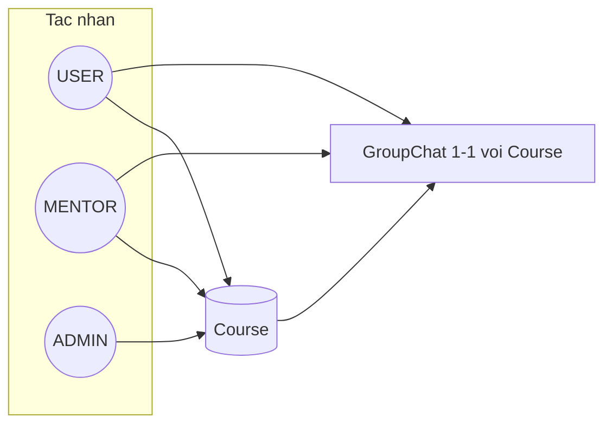
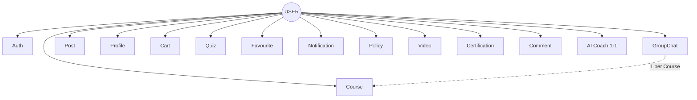
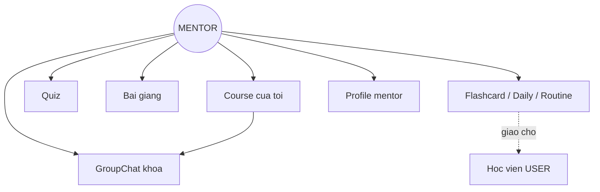
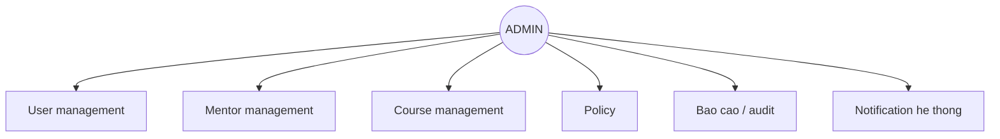
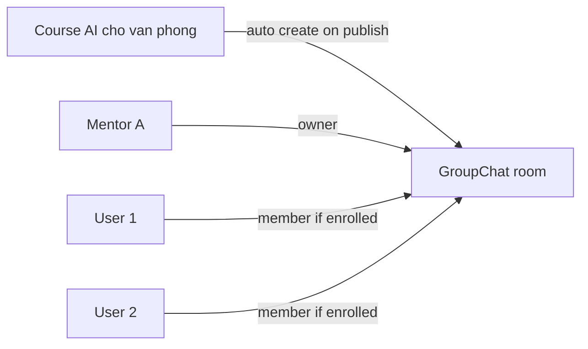

# Tác nhân & Use case — GATS Academy (draft)

Tài liệu mô tả **3 tác nhân** tách riêng: **USER** (học viên), **MENTOR**, **ADMIN** — dựa trên mind map gốc + ghi chú sản phẩm của bạn.

**Liên quan:** [`app-flow.md`](app-flow.md) · [`design-system.md`](design-system.md)

---

## Quy ước quan trọng

| Quy tắc | Chi tiết |
|---|---|
| **1 khóa = 1 GroupChat** | Mỗi `Course` có đúng một phòng chat nhóm. Học viên đã enroll và mentor phụ trách khóa đó mới vào được. |
| **Mock theo role** | Tạm **bỏ mock rải rác** trong UI. Thay bằng **3 mock account gọn**: `mock_user`, `mock_mentor`, `mock_admin` — mỗi role một luồng quyền rõ. |
| **AI Coach ≠ GroupChat** | Tab Coach = chat AI 1-1 (học viên). GroupChat = chat cohort theo khóa (mentor ↔ học viên). |
| **Không có role Guest** | Chỉ 3 role: USER, MENTOR, ADMIN. Bỏ qua login = **chưa đăng nhập** (không gán role), không phải tác nhân riêng. |
| **Mentor ↔ khóa** | Admin phân bổ; mỗi mentor thường **5–6 khóa** (linh hoạt theo admin). |

---

## Ba tác nhân



| Tác nhân | Vai trò | Mock account (draft) |
|---|---|---|
| **USER** | Học viên — học, làm quiz, chat nhóm, mua/enroll | `mock_user` / email `user@gats.demo` |
| **MENTOR** | Giảng viên / coach khóa — upload bài giảng, giao quiz, chat học viên | `mock_mentor` / email `mentor@gats.demo` |
| **ADMIN** | Vận hành hệ thống — quản lý sạch user, khóa, mentor, policy | `mock_admin` / email `admin@gats.demo` |

---

## USER (Học viên)

Use case từ mind map gốc — **chỉ hành động học viên được phép**.



### USER — chi tiết module

| Module | Use case | Ghi chú |
|---|---|---|
| **Auth** | Login, Register, Reset password | **Bỏ qua** Entry → vào app **không đăng nhập** (không role). Muốn enroll/chat cần login USER |
| **Course** | Xem khóa, tài liệu, tìm kiếm, đăng ký, tải tài liệu, đánh giá khóa | Chỉ khóa đã enroll / free |
| **GroupChat** | Xem, Sent | **Theo khóa đã tham gia** — không chat chéo khóa |
| **Quiz** | Làm bài tập, Lưu bài tập | Quiz **trong khóa** — khác onboarding survey |
| **Post** | Xem, Tìm kiếm | Feed / forum học viên |
| **Profile** | Thêm, Cập nhật, Xóa account | |
| **Cart** | Thêm, Sửa, Xóa | Trước khi enroll trả phí |
| **Favourite** | Thêm / Xóa khóa học, bài viết | |
| **Notification** | Nhận từ khóa học, bài viết | |
| **Policy** | Hoàn tiền, Học bổng | Yêu cầu / tra cứu |
| **Video** | Bookmark timestamp | Trong bài giảng |
| **Certification** | Xem / thi / nhận chứng chỉ | Khi đủ điều kiện |
| **Comment** | Post, Like, Reply | Gắn **Post** và **Lecture** (cả hai) |
| **AI Coach** | Chat 1-1 AI | Tab Coach — **không** thay GroupChat |

### USER — phân biệt Quiz

| Loại | Mục đích | Ai dùng |
|---|---|---|
| **Onboarding survey** | 3 câu: trình độ, tuổi, mục đích → gợi ý khóa | USER (lần đầu) |
| **Quiz in-course** | Bài tập / kiểm tra trong khóa | USER (đã enroll) |

---

## MENTOR (Giảng viên / Coach khóa)

**Không** có trong mind map USER gốc — tác nhân riêng, gắn **khóa được phân công**.



### MENTOR — use case

| Module | Use case | Mô tả |
|---|---|---|
| **Course** | Xem / quản lý khóa được gán | Tối đa **~5–6 khóa** do admin phân bổ; không sửa khóa khác |
| **Bài giảng** | Thêm, Sửa, Xóa, Xuất bản | Video, slide, tài liệu, module trong khóa |
| **Quiz** | Tạo, Sửa, Xuất bản, Xem kết quả | Giao bài cho học viên trong khóa |
| **Flashcard / Daily / Routine** | Tạo deck, giao bài ôn, gợi ý routine | Mentor soạn & **giao cho học viên** khóa; học viên làm trên tab Daily |
| **GroupChat** | Xem, Sent, Pin / announce | Chat với **toàn bộ học viên** trong khóa (1 room / course) |
| **Notification** | Gửi nhắc học, deadline | Push tới học viên khóa đó |
| **Profile** | Cập nhật hồ sơ mentor | Bio, avatar, chuyên môn |

### MENTOR — không được (mặc định)

- Xóa user / admin khóa hệ thống
- Refund / học bổng (Policy admin)
- Enroll thay học viên vào khóa trả phí (trừ khi admin cho phép)

---

## ADMIN (Quản trị)

Vận hành **sạch** toàn nền tảng — user, mentor, khóa, policy.



### ADMIN — use case

| Module | Use case | Mô tả |
|---|---|---|
| **User** | Xem, Khóa/Mở, Xóa, Reset | Quản lý tài khoản học viên |
| **Mentor** | Thêm, Gán khóa, Thu hồi quyền | Gán mentor ↔ course (**~5–6 khóa / mentor**, tùy admin) |
| **Course** | CRUD khóa, publish/unpublish | Tạo khóa → **tự sinh 1 GroupChat** |
| **Policy** | Duyệt hoàn tiền, học bổng | Approve / reject |
| **Cart / Order** | Xem đơn, hoàn tiền admin | Hỗ trợ thanh toán |
| **Báo cáo** | Thống kê enroll, completion, doanh thu | Dashboard (web/admin app sau) |
| **Notification** | Broadcast toàn hệ thống | Tin chung, bảo trì |

### ADMIN — nền tảng mobile (tạm thời)

- **Mobile:** có shell admin riêng (như mentor — tab quản lý), **không** chờ web admin.
- **Sau này:** có thể bổ sung web dashboard cho báo cáo / thao tác nặng.

### ADMIN — không làm thay mentor

- Soạn bài giảng chi tiết từng module (ủy quyền mentor)
- Chat hàng ngày trong GroupChat khóa (có thể **xem audit** nhưng không thay vai mentor)

---

## GroupChat — mô hình 1 khóa = 1 phòng



| Thành phần | Quy tắc |
|---|---|
| **Tạo phòng** | Khi admin/mentor publish khóa (hoặc admin tạo khóa) |
| **Thành viên** | Học viên **sau enroll**; mentor được gán; admin audit (optional) |
| **Tin nhắn** | USER: Sent, Xem · MENTOR: Sent, Xem, pin thông báo |
| **UI gợi ý** | Tab / màn trong **chi tiết khóa**, không tab global chung tất cả khóa |

---

## Ma trận quyền (rút gọn)

| Hành động | USER | MENTOR | ADMIN |
|---|:---:|:---:|:---:|
| Enroll / mua khóa | ✓ | — | — |
| Xem bài giảng (đã enroll) | ✓ | ✓ (khóa mình) | ✓ |
| Tạo / sửa bài giảng | — | ✓ | ✓ (override) |
| Tạo / chấm quiz in-course | — | ✓ | — |
| Làm quiz in-course | ✓ | — | — |
| GroupChat Sent | ✓ | ✓ | audit |
| AI Coach 1-1 | ✓ | — | — |
| Tạo / giao flashcard, daily task | — | ✓ | — |
| Làm flashcard / daily (được giao) | ✓ | — | — |
| Comment (Post + Lecture) | ✓ | ✓ (moderate) | audit |
| CRUD user | — | — | ✓ |
| Gán mentor ↔ khóa (~5–6 / mentor) | — | — | ✓ |
| Duyệt hoàn tiền | yêu cầu | — | ✓ |

---

## Chiến lược mock (nhẹ, 3 account)

**Hướng:** gom mock vào layer data/role, không mock rải từng màn.

| Mock | Role | Dùng để test |
|---|---|---|
| `mock_user` | `UserRole.user` | Enroll, học, làm quiz, chat nhóm, AI Coach |
| `mock_mentor` | `UserRole.mentor` | Upload bài, tạo quiz, chat học viên khóa A |
| `mock_admin` | `UserRole.admin` | CRUD khóa/user, gán mentor, policy |

**Đã implement (P0):**

```
lib/
  features/auth/models/user_role.dart
  data/mock/mock_accounts.dart
  data/mock/mock_course_store.dart
  data/mock/mock_group_chat_store.dart
  shell/role_shell.dart · mentor_shell.dart · admin_shell.dart
```

**Bỏ / gộp mock phụ hiện tại:**

| Hiện tại | Hướng xử lý |
|---|---|
| `MockData` rải courses/userName | → `mock_course_store` + gắn `mentorId`, `groupChatId` |
| `MockAuthService` user cố định Google/Apple | → login chọn role / email demo 3 account |
| AI Coach reply cố định | Giữ tối thiểu cho USER, không nhân đôi GroupChat |

---

## Map app mobile hiện tại → 3 role

| Màn / tab hiện có | USER | MENTOR | ADMIN |
|---|---|---|---|
| Entry + Onboarding | ✓ (đã login USER) | — | — |
| Login mock + 3 demo account | ✓ | ✓ | ✓ |
| Bỏ qua login | xem hạn chế, **không role** | — | — |
| Home / Library | ✓ | — | — |
| Daily / Flashcard | ✓ (nhận bài mentor giao) | giao bài *(chưa UI)* | — |
| Coach (AI) | ✓ | — | — |
| Hub / Cert | ✓ | — | — |
| Settings | ✓ | ✓ | ✓ |
| GroupChat per course | ✓ | ✓ | audit |
| Mentor shell | — | ✓ | — |
| Admin shell (mobile) | — | — | ✓ |

---

## Quyết định sản phẩm (đã chốt)

| # | Câu hỏi | Quyết định |
|---|---|---|
| 1 | **Bỏ qua login** — có role Guest? | **Không.** Không có role Guest. Bỏ qua = chưa đăng nhập, không gán USER/MENTOR/ADMIN. |
| 2 | **Admin** — web hay mobile? | **Mobile tạm thời** (shell riêng như mentor). Web dashboard có thể thêm sau. |
| 3 | **Comment** gắn đâu? | **Cả Post và Lecture.** |
| 4 | **Một mentor** tối đa bao nhiêu khóa? | **~5–6 khóa**, do admin phân bổ (linh hoạt). |
| 5 | **Flashcard / Daily / Routine** — ai dùng? | **USER** làm bài được giao. **MENTOR** tạo flashcard/deck, giao daily task & routine cho học viên trong khóa. |

### Flashcard / Daily / Routine — chi tiết

| Thành phần | USER | MENTOR |
|---|---|---|
| **Flashcard deck** | Ôn deck được mentor giao / từ khóa đang học | Tạo deck, gán cho khóa hoặc học viên |
| **Daily tasks** | Xem & hoàn thành task hôm nay | Giao task (ôn flashcard, đọc bài, v.v.) |
| **Routine workflow** | Chạy routine cá nhân (có thể từ gợi ý mentor) | Thiết kế / gợi ý routine mẫu cho khóa *(phase sau)* |

---

## Phase gợi ý (cập nhật)

| Phase | Nội dung |
|---|---|
| **P0** | 3 mock role + auth chọn role; Course + enroll mock; GroupChat 1-1/course (USER + MENTOR) |
| **P1** | Quiz in-course; bài giảng mock; mentor **giao flashcard/daily**; notification khóa |
| **P2** | Cart, Policy; ADMIN gán mentor (cap 5–6); certification; Comment Post + Lecture |
| **P3** | Post, Comment, forum; admin dashboard |

---

## Changelog

| Ngày | Người sửa | Nội dung |
|---|---|---|
| 2026-07-01 | AI draft | Mind map USER ban đầu |
| 2026-07-01 | AI + user | Tách USER / MENTOR / ADMIN; 1 course = 1 GroupChat; mock 3 role |
| 2026-07-01 | User | Chốt: không Guest; admin mobile; comment Post+Lecture; mentor ~5–6 khóa; mentor giao flashcard/daily |
